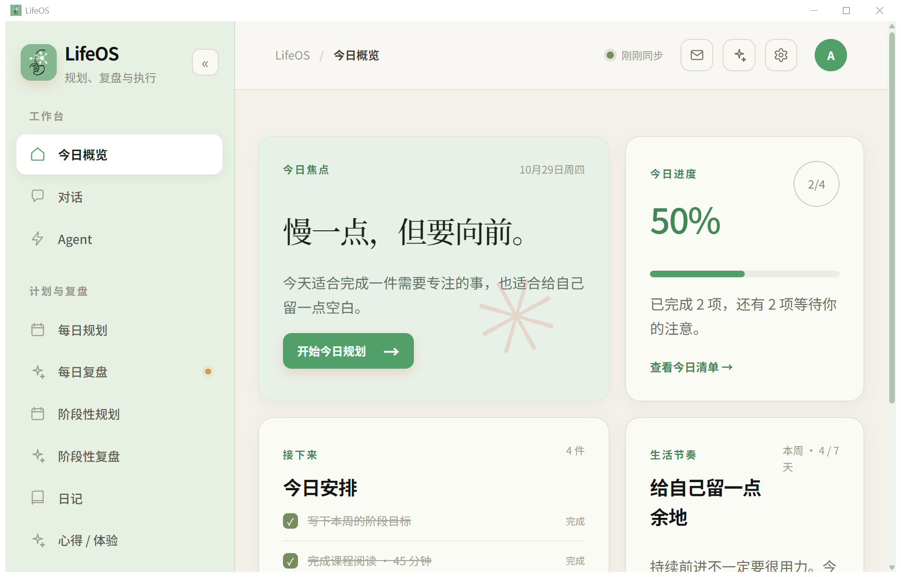

<p align="center">
  
</p>

<div align="center">
  <h1>LifeOS</h1>
  <p><b>“记得住、能动手、真懂你”的个人智能操作系统</b></p>
  <p>简体中文 · <a href="README.en.md">English</a></p>
  <a href="https://github.com/yubr-zzh/AIC-LifeOS/stargazers"></a>
  
  
  
  
  <a href="LICENSE"></a>
</div>

---

**LifeOS** 是一个装在本地的个人智能操作系统，让 AI 助手从“一次性问答”变成“记得住、能动手、沉淀用户画像以更懂用户”的长期搭档，兼具记忆、执行与复盘功能。

**问题**：多会话 AI 工具每次都要重新交代背景，当前 session 已经走通的路线下次还得再摸索。通用助手一般分不清"现在的结论"和"过时的旧结论"；而当前的 AI 助手，多数也无法沉淀长期用户画像。隔一段时间，再问它"你在做什么""之前做过什么"，它其实并不了解。

**方案**：LifeOS 用可靠的本地事件总线连接前台对话 Agent 与后台反思 Agent；记忆分四层——原始证据、项目连续性、原子记忆、全局画像，按项目隔离而不是混成一锅；记忆写入走"候选 → 人工审核生效"的路线，支持纠正、撤回与失效；规划与复盘在应用内完成。



## 安装

- 首选：到 release 下载 `LifeOS-Setup-2.2.4.exe`。

    安装步骤：
  1. 运行 `LifeOS-Setup-2.2.4.exe`。
  2. 按向导操作。保留默认选项。
  3. 从开始菜单或桌面快捷方式启动 LifeOS。
  4. 首次启动时创建本地账户。

----
- 手动构建：

```bash
# 1) 拉代码并装依赖
git clone https://github.com/yubr-zzh/AIC-LifeOS.git && cd AIC-LifeOS

# 2) 前端构建（产出 frontend/dist）
cd frontend && npm install && npm run build && cd ..

# 3) 打包 Windows 桌面端（产出 dist\LifeOS\LifeOS.exe）
python -m PyInstaller --noconfirm --clean tools/lifeos.spec
```
----
- 只测试、不想安装软件：解压 `dist\LifeOS` 后双击 `LifeOS.exe`。
----
- 数据存储：
  用户数据存放在 `%USERPROFILE%\lifeOS`。
  首次启动从 AppData 旧目录复制数据。原目录保留为备份。


## 工作原理

```text
LifeOS.exe（pywebview 桌面壳，单实例）
  └─ lifeos.api.server（主服务，8765 起自动探测端口）
       ├─ 静态托管 frontend/dist + SPA fallback（打包态同源，无 CORS）
       ├─ 登录闸：本地账户 + PBKDF2 + HttpOnly 会话 Cookie + CSRF
       └─ bridge 子进程（lifeos.bridge.run）
            └─ Agent 适配器（claude_code 等，经 claude-agent-sdk 调本机 CLI）

核心数据流：
用户输入 → Chat Agent（记忆检索 → LLM/工具）→ 响应
        → 可靠事件总线 → Global Agent → 反思
        → 记忆候选 → 安全审查 → 持久化
```

## lifeOS特点

**三思而后行：**Agent 每写一个文件、每跑一条命令，都先送到你眼前——你点头，它才动手。

**日久见汝心：**让这台机器随日子慢慢懂你。对话沉淀为记忆，记忆喂养反思，反思长出技能；今日的事今日勾，阶段有计划可依、事后有复盘可查，年末一张图收拢全局。

**深藏数与据：**笔记、日程、代码、对话，都收在 `%USERPROFILE%\lifeOS` 的本地库里，不经过别人的服务器。

### 日常使用

**进门。** 双击运行，首次启动创建本地账户。勾选记住密码，可 30 天免登录，凭据经系统级加密存放。

**派活。** Agent 页以卡片列出本机 Agent 的状态、版本和连接清单。选一个并指定文件夹，它在里面读文件、改代码、跑命令，每个动作先给你过目。详情抽屉显示 Bridge 健康状态，可随时重新检测。

**对话。** 每一轮收在一个区块里：先是你的问题，然后是回答。回答按 Markdown 渲染，公式正常显示。工具调用收成一行。只读类调用完成后变成一行纯文字。命令与文件写入留一行，点开可看输入和结果。失败和待审批始终展开，处理完才收起。思考过程单独成行。每轮底部有一条折叠带，列出这一轮读过的文件和搜索模式。鼠标移到一轮上，可以复制或重试。正文流式输出；单条过长会分成几条消息，内容一字不少。Agent 干活时按回车，消息先排队，本轮结束再发出。需要你选择或授权时，选择框和权限请求框照常弹出，答完 Agent 继续跑。此前的聊天与 Agent 执行结果会沉淀为记忆，主模型能读到 Agent 的完整回复。消息一键复制，会话可重命名，单条消息最多附 3 个文件，每个不超过 200 KB。

**当日。** 今日工作台逐项打勾，20 组提醒每天准时到，Agent 的结果和待办汇进右上角 Inbox。侧栏可收起，对话区可拖拽调宽。

**经年。** 每日与阶段计划用 Markdown 写。编辑器支持斜杠命令：任务清单、无序列表、有序列表、标题、引用。复盘自动承接计划条目。年度工作历以贡献图风格收拢全年规划、复盘、日记与心得，一眼扫完。

### 几点提示

- 关闭窗口即收工，所有后台进程一并退出，不留驻守。
- Agent 未连接时也能先写好草稿，不必干等。
- 卸载会先询问，你确认之后才该数据。
- 账户、记忆、日志都在 `%USERPROFILE%\lifeOS`，备份认准该文件夹。

## 源码结构

```text
lifeos/
  desktop/          # 桌面壳入口：单实例、端口、关停时序
  api/              # 主服务：静态托管、登录闸、隧道网关、设备、用户
  bridge/           # 本地 Agent 进程：适配器、仲裁、脱敏、恢复
  agent/            # Chat Agent、Global Agent、规划、执行
  memory/           # 两阶段记忆写入：检索、候选、生命周期、治理、图谱与时间版本
  skills/           # 技能注册表、候选检测、效果评估
  reflection/       # 后台反思引擎
  event/            # 本地可靠事件队列
  security/         # 权限审查
  llm/              # 统一 LLM 接口
  mcp/              # MCP Server 注册表与适配
frontend/           # React + TypeScript + Vite 控制台（npm run build 产 dist）
tools/              # build_exe.ps1、lifeos.spec、lifeos-setup.iss、verify_*.py
tests/              # 后端全量测试
datasets/           # 记忆治理评测样本与 LongMemEval-S 模板
docs/               # 架构与 API 文档
```

## 开发、贡献时从源码构建

需要 Windows 10 或 11，外加：

- Python 3.11 或更高（开发机实测 3.13）
- Node.js，构建前端
- Inno Setup 6，仅出安装器时需要

```powershell
# 1) 后端虚拟环境
python -m venv .venv
.venv\Scripts\python -m pip install -r requirements.txt

# 2) 前端依赖
cd frontend
npm ci
cd ..

# 3) 一键打包：npm run build → PyInstaller
powershell -ExecutionPolicy Bypass -File tools\build_exe.ps1

# 4) 编译安装器，可选
ISCC.exe tools\lifeos-setup.iss
```

产物：`dist\LifeOS\LifeOS.exe`（onedir）和 `dist\LifeOS-Setup-2.2.4.exe`（安装器）。

## 开发调试

```powershell
# 后端（LIFEOS_HOME 指定数据根，默认 ./lifeOS/）
.venv\Scripts\python -m lifeos.api.server

# 前端热更（5173，vite 代理 /api 到后端）
cd frontend && npm run dev

# 桌面链路冒烟：/api 归一 + 直连代理 + bridge/start
.venv\Scripts\python tools\verify_desktop_link.py
```

## 测试

```powershell
# 后端，约 930 个用例
.venv\Scripts\python -m pytest tests -q
.venv\Scripts\python -m compileall lifeos

# 前端，约 190 个用例，另附类型检查
cd frontend
npm test
npm run typecheck
```

三个后端文件（`tests/test_codex_lc_ji_cheng.py`、`test_liu_xing_lc_ji_cheng.py`、`test_pi_lc_ji_cheng.py`）会访问真实外网端点。离线或 CI 环境请加 `--ignore` 排除。

## 文档索引

- [docs/api-contract.md](docs/api-contract.md)，前后端 API 对齐
- [docs/agent-memory-integration.md](docs/agent-memory-integration.md)，Agent 执行结果进入记忆的流程
- [docs/memory-module-handoff.md](docs/memory-module-handoff.md)，记忆模块交接
- [docs/memory-design-principles.md](docs/memory-design-principles.md)，记忆设计原则
- [docs/memory-provider-boundaries.md](docs/memory-provider-boundaries.md)，记忆 Provider 边界
- [docs/lifeos-workflow-and-memory-architecture.md](docs/lifeos-workflow-and-memory-architecture.md)，工作流与记忆架构
- [docs/team-module-integration-plan.md](docs/team-module-integration-plan.md)，团队模块集成方案
- [docs/frontend-rewrite-issues.md](docs/frontend-rewrite-issues.md)，前端重构问题记录
- [docs/tencentdb-approved-atomic-create-proposal.md](docs/tencentdb-approved-atomic-create-proposal.md)，TencentDB 原子创建方案

## 参与贡献

见 [CONTRIBUTING.zh-CN.md](CONTRIBUTING.zh-CN.md)。内容包括开发流程、测试命令和提交信息规范。

## 许可证

MIT，见 [LICENSE](LICENSE)。
