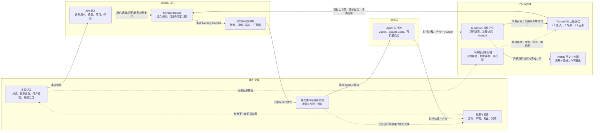
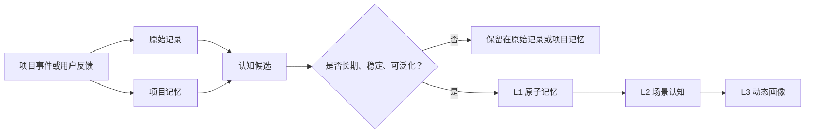

# LifeOS 整体流程与 Memory 架构设计

> 文档状态：目标架构草案
> 对应流程图：`LifeOS 整体工作流程 v2`
> 核心定位：**AI + 日记本式长期 Memory + 执行能力**

## 1. 文档目的

本文将 LifeOS 新版流程图落地为可讨论、可拆分和可实现的架构说明，重点回答以下问题：

1. LifeOS 从哪些渠道获得用户记录？
2. 原始记录、项目记忆与长期认知如何分层？
3. `ai-memory` 与 `TencentDB-Agent-Memory` 是否需要融合，以及如何协同？
4. LifeOS 如何在一次任务中组合 Memory、生成计划并调度执行 Agent？
5. 执行结果如何重新进入记录和记忆系统，形成长期闭环？

本文描述的是目标架构，不代表所有模块均已完成实现。

## 2. 产品定位

LifeOS 不只是聊天工具，也不只是替用户调用 Agent 的启动器。它承担三个长期职责：

- **AI 协作入口**：理解用户当前请求，结合长期上下文生成回答或行动方案。
- **日记本式 Memory**：保存历史记录，并从中提炼会影响后续理解与决策的长期认知。
- **执行管理中枢**：在需要实际行动时，选择并协调 Codex、Claude Code 等执行后端。

在单 Agent 模式下，LifeOS 为用户补充上下文、规划和记忆；在多 Agent 模式下，LifeOS 更接近管理中枢，负责任务拆解、Agent 路由、上下文分发、授权、状态跟踪和结果汇总。

## 3. 整体架构与数据流



这张图包含两条相互配合的链路：

- **主服务链路**：输入 → 识别 → Memory 召回 → 规划 → 模式与授权 → Agent 执行 → 结果反馈。
- **Memory 链路**：多源记录/执行过程 → 原始归档与项目记忆 → 长期认知提炼 → 动态召回 → 支持下一次决策。

## 4. 主服务流程

### 4.1 多源记录进入 LifeOS

Memory 的来源不只包括执行 Agent 的日志。首期应覆盖：

| 来源 | 典型内容 | 默认去向 |
| --- | --- | --- |
| LifeOS 对话 | 用户问题、补充说明、偏好表达、纠正 | 原始记录；必要时生成认知候选 |
| 每日规划与复盘 | 今日目标、完成情况、阻塞、状态 | 原始记录；学习/工作场景记忆 |
| 阶段规划与复盘 | 阶段目标、策略变化、经验总结 | 原始记录；场景记忆与画像候选 |
| 项目活动 | 需求、架构、决策、代码进展、待办 | 项目原始记录与 ai-memory |
| Agent 执行 | 执行步骤、工具调用、产物、Handoff | ai-memory；必要时生成认知候选 |
| 用户反馈 | 接受、拒绝、修改、验收结果 | 原始记录；偏好与协作方式候选 |
| 外部工具 | GitHub、邮件、日历、Notion、云盘等 | 原始记录或对应项目记录 |

接入层必须为每条记录附加基本上下文：

- `user_id`：记录属于谁；
- `source_type`：对话、规划、复盘、Agent、外部工具等；
- `scenario_type`：学习、项目、文档、信息执行、外部操作；
- `project_id`：属于具体项目时必须填写；
- `occurred_at`：事件发生时间；
- `source_ref`：原始文件、会话、任务或外部对象的引用；
- `authorization_scope`：允许用于哪些召回与执行场景。

### 4.2 API 接入与上下文识别

API 接入层不负责直接生成长期记忆。它先完成请求标准化与上下文定位：

1. 确认用户身份和会话；
2. 判断当前属于哪个场景；
3. 判断是否属于某个具体项目；
4. 提取当前任务、约束和期望产物；
5. 将检索条件交给 Memory Router。

### 4.3 Memory Router 动态组合

Memory Router 是 LifeOS 使用 Memory 的统一入口，但不是新的权威数据库。它按当前任务动态组织以下内容：

```text
Memory Context = 全局核心画像
               + 当前场景画像
               + 当前项目记忆
               + 与任务相关的原子记忆
               + 必要时回读的原始证据
```

召回应遵循“先隔离、后扩展”的原则：

1. 先限定当前用户；
2. 有 `project_id` 时优先召回当前项目；
3. 再补充当前场景下的稳定认知；
4. 最后加入少量全局核心画像；
5. 只有需要验证、解释或恢复细节时，才回读原始记录。

Memory Context 是一次性运行上下文，不应整体写回长期记忆，也不应把动态召回结果永久塞入对话历史。

### 4.4 规划与调度

规划与调度中枢接收当前请求和 Memory Context，输出：

- 对用户目标的解释；
- 可执行计划或直接回答；
- 任务拆分及依赖关系；
- 推荐的执行 Agent；
- 每个 Agent 所需的最小上下文；
- 风险操作与授权要求；
- 验收标准和预期产物。

多 Agent 模式下，LifeOS 维护中央任务图。Agent 可以提出调整建议，但任务图和上下文分发的最终决定权在 LifeOS。

### 4.5 模式选择与权限

LifeOS 提供三种执行模式：

- **手动模式**：用户选择执行 Agent，并逐项确认关键操作。
- **推荐模式**：LifeOS 推荐 Agent 和方案，用户确认后执行。
- **自动模式**：在预先授权的范围内自动选择和调度 Agent。

模式配置的优先级为：

```text
单次任务覆盖 > 项目设置 > 全局默认
```

权限分成两层：

1. **LifeOS 业务授权**：用户是否同意执行某类任务、访问某类数据或调用某个外部系统。
2. **Agent 原生权限**：Codex、Claude Code 等执行后端自身的沙箱、文件、网络和工具授权。

LifeOS 不绕过执行 Agent 的原生安全机制。

### 4.6 Agent 执行与结果反馈

LifeOS 只统一最小执行生命周期，不强行抹平不同 Agent 的能力差异。统一部分至少包括：

- 任务标识和状态；
- 输入上下文与任务约束；
- 业务授权范围；
- 启动、暂停、取消和失败信息；
- 产物位置与执行摘要；
- 可供下一 Agent 或下一会话接续的 Handoff。

具体工具能力、交互方式、模型特点和原生权限仍由各 Agent Adapter 保留。首个样板后端为 Codex，Claude Code 次之，后续可接入 Pi、Hermes、DeepSeek Harness 等。

执行结束后，用户可以验收、修正、拒绝或标记完成。结果和反馈会成为下一轮记录来源。

## 5. Memory 分层设计

### 5.1 L0：原始记录归档

原始记录是事实和证据层，目标是“完整保存，但不常驻上下文”。

- 保存原始对话、计划、复盘、文件引用、执行日志和反馈；
- 原文存盘，支持按照来源和时间追溯；
- 默认不直接参与每次推理；
- 仅在召回结果需要验证或补充细节时按需读取；
- 原始记录不等于长期 Memory。

### 5.2 ai-memory：项目记忆

ai-memory 回答的问题是：**这个具体项目发生了什么，现在进行到哪里？**

其职责包括：

- 每个项目独立保存，默认互不污染；
- 记录项目背景、重要决策、当前进展、阻塞和下一步；
- 保存 Agent 执行产物索引与 Handoff；
- 通过 Git/Markdown 形式支持版本化、审查和回滚；
- 支持 Codex、Claude Code 等不同 Agent 接续同一项目。

项目专属事实原则上保留在 ai-memory 中，不自动提升为全局用户认知。

### 5.3 TencentDB：长期认知记忆

TencentDB-Agent-Memory 回答的问题是：**LifeOS 应该如何理解用户，并据此改进后续协作？**

建议采用以下逻辑层次：

| 层级 | 内容 | 示例 |
| --- | --- | --- |
| L1 原子记忆 | 一条可追溯、可更新的认知 | 用户在重要架构决策前希望比较备选方案 |
| L2 场景记忆 | 某类场景中的稳定模式 | 在编程项目中偏好先完成可运行样板 |
| L3 动态画像 | 多条记忆生成的当前视图 | 全局核心画像、学习画像、项目协作画像 |

每条长期记忆至少需要：

- 内容与类型；
- 来源引用；
- 首次发现与最近确认时间；
- 置信度；
- 适用场景和项目范围；
- 支持证据与反例；
- 当前状态：候选、有效、弱化、冲突或废弃。

画像不是一段不可解释的固定总结，而是由多条带来源、时间和置信度的 Memory 动态生成的可更新视图。

### 5.4 记忆纠错、撤回与删除

LifeOS 区分候选记忆与已采纳记忆，并区分“不再用于当前理解”和“彻底删除”：

- 候选记忆尚未成为用户认可的长期认知，系统可自动去重、合并、降低置信度或丢弃，但必须保留候选来源和处理结果。
- 对已采纳记忆，系统不得静默覆盖其含义。发现新证据或冲突时，可以自动标记旧记忆为“可能过时/待确认”，并提出替代候选；未经确认，不把新说法直接确认为用户当前事实。
- 用户明确纠正时，新增一条带来源的修正记忆，并将旧条目标记为“已被替代”；旧版退出当前检索和画像视图，但保留必要的版本关联与来源审计。
- 用户明确要求撤回时，将条目标记为“已撤回”，并从后续检索和派生画像中排除。撤回不等于删除原始记录。
- 彻底删除是独立且更强的操作：须有用户明确意图或授权，并按删除范围清理记忆、派生画像、检索索引和缓存；是否同时删除原始来源，按来源数据的独立保留规则处理。

除候选阶段的自动整理外，实质改变已采纳认知或执行不可逆删除前，必须尊重用户确认边界。当前 MVP 先实现可逆的替代/撤回语义；硬删除级联、备份保留期限和多层存储同步暂不在本阶段实现。

当前后端 MVP 通过 `POST /memory/{id}/correct` 和 `POST /memory/{id}/retract` 接收明确操作：纠正写入关联的新版本，撤回写入 tombstone 状态；两者都会使旧条目退出召回、移除对应向量项并清空缓存。Markdown 导入不能覆盖或移除既有 Memory。`needs_confirmation` 冲突状态和硬删除尚未实现。

## 6. ai-memory 与 TencentDB 的组合方式

两者需要在 LifeOS 中协同，但不需要物理合并，也不应全量双向同步。

| 模块 | 权威范围 | 不负责的内容 |
| --- | --- | --- |
| 原始记录归档 | 当时具体发生了什么 | 长期认知判断 |
| ai-memory | 具体项目的事实、进展和连续性 | 全局用户画像 |
| TencentDB | 原子认知、场景认知和动态画像 | 完整项目日志与所有原始文件 |
| Memory Router | 本次任务的动态组合与裁剪 | 成为第三套权威存储 |

组合发生在两个时刻：

### 6.1 读取时联合召回

Memory Router 同时获取项目上下文和长期认知，再生成本次 Memory Context。两套存储仍保持各自权威边界。

### 6.2 写入时单向晋升

项目执行中出现的内容先进入项目记忆。只有满足长期价值条件的认知，才作为候选单向晋升到 TencentDB。



例如：

- “项目 A 使用 Next.js”属于项目事实，留在 ai-memory；
- “用户在编程项目中常先做可运行原型”可能晋升为项目场景认知；
- “用户在重要决策前希望看到备选方案与取舍”可能进入全局核心画像。

具体晋升阈值、跨项目证据数量和人工确认机制需要另行制定，不在本文中预设。

## 7. 场景画像与项目隔离

首期场景大致分为：

1. **学习型**：学习目标、知识基础、节奏、薄弱点和反馈偏好；
2. **项目型**：项目目标、技术决策、进展、阻塞和协作方式；
3. **文档型**：写作目的、读者、风格、修改习惯和质量标准；
4. **信息执行型**：搜索、调研、提取、比较、整理和来源偏好；
5. **外部操作型**：GitHub、邮件、日历、Notion、云盘等工具操作。

项目型场景下可以存在多个项目实例。项目记忆默认按照 `user_id + project_id` 隔离；只有经过明确晋升流程的认知，才能进入场景层或全局层。

## 8. 历史工作图

Archify 历史工作图不是新的 Memory 权威源，而是项目记忆的可视化视图。它可以展示：

- 近期任务与完成情况；
- 项目关键决策和阶段节点；
- Agent 执行记录与产物关系；
- 当前阻塞、依赖和下一步；
- 不同阶段的工作轨迹。

图中的事实应能回到 ai-memory 或原始记录，不在可视化层单独维护不可追溯的数据。

## 9. 首期落地边界

首期建议优先验证一条完整纵向链路，而不是同时实现所有 Agent 和外部工具：

1. 接入 LifeOS 对话、规划/复盘和 Codex 执行记录；
2. 将原始记录可靠存盘，并保留来源引用；
3. 使用 ai-memory 管理一个具体项目的连续上下文与 Handoff；
4. 使用 TencentDB-Agent-Memory 保存 L1 原子记忆，并生成基础场景画像；
5. 实现 Memory Router，生成一次任务所需的 Memory Context；
6. 完成 Codex 执行、结果反馈和再次沉淀的闭环；
7. 再扩展 Claude Code、多 Agent 任务图和外部工具。

首期成功的判断标准不是“保存了多少信息”，而是：

- 用户无需反复解释稳定背景；
- 项目切换后能够恢复正确上下文；
- 召回内容有来源、不过度越界且不会污染其他项目；
- Agent 能获得完成任务所需的最小上下文；
- 用户反馈能修正后续理解，而不是永久固化错误画像。

## 10. 待进一步决策的问题

以下问题需要在后续设计中单独讨论：

- 项目记忆晋升为场景或全局记忆的具体条件；
- 记忆冲突的自动判定阈值、待确认提醒策略，以及硬删除时的备份/原始来源保留期限；
- 用户对画像的查看、编辑和删除权限；
- 敏感信息的分类、加密和授权范围；
- 多 Agent 任务图的状态模型与失败恢复；
- 外部产品和工具的合规接入方式；
- Memory 效果评估指标与测试集设计。

## 11. 核心原则总结

1. **原始记录与长期 Memory 分离**：完整历史存盘，长期认知保持精炼。
2. **Memory 来源多元**：对话、规划复盘、项目活动、Agent 和外部工具都是来源。
3. **项目默认隔离**：项目事实不能无条件污染其他项目或全局画像。
4. **两套记忆各有权威边界**：ai-memory 管项目连续性，TencentDB 管长期认知。
5. **使用时动态组合**：Memory Router 为当前任务生成最小、相关、可追溯的上下文。
6. **LifeOS 管理但不抹平 Agent 差异**：统一生命周期与授权边界，保留各执行后端特长。
7. **反馈形成闭环**：执行和用户反馈重新进入记录系统，持续修正 LifeOS 对用户的理解。
