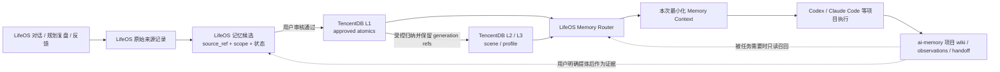

# LifeOS 外部记忆能力组合与数据权威

> 状态：阶段 8 修订后的目标架构决策；阶段 9 代码切片已完成，端到端验收未完成（2026-10-05）
> 说明：目标是实际使用 `ai-memory` 与 TencentDB Agent Memory 的互补能力。LifeOS 已有 TencentDB L1 首写/更新离线切片和 ai-memory 显式项目范围只读切片；37 项回归通过，其中包括本地合成 HTTP mock 的端到端链路。TencentDB create 依赖尚未合并的 Draft PR #1604，未做真实 Gateway 联调，TCVDB 仍不支持 atomic create；L2/L3、真实后端验收和迁移切换未完成。

## 核心决策

1. **两个项目都是目标方案中的实际能力组件，不是“只作参考”或可有可无。** `ai-memory` 承担具体项目的 Agent 工作连续性；TencentDB Agent Memory 承担跨来源的分层长期认知（L1 原子、L2 场景、L3 画像）。
2. **LifeOS 是用户入口、授权/审核边界和编排中枢。** 它负责接收多源记录、确定用户/场景/项目范围、审核候选、决定何时调用哪种后端，并将带来源的结果组合到本次任务上下文。
3. **权威按数据职责划分，而非让三套系统保存同一份 active 记忆：** `ai-memory` 的 Git Markdown wiki 是具体 coding project 连续性的权威；TencentDB 是已审核长期认知 L1 及其 L2/L3 派生层的目标权威；LifeOS 保留来源记录、授权/候选/审核与跨系统引用。LifeOS 当前 `.lifeos/memory.json` 的 active Memory 是阶段 2–7 的本地 MVP，目标上属于迁移期实现，不应与 TencentDB 永久双写。
4. **LifeOS 审核先于语义记忆写入。** 新认知先成为带 source/scope 的 LifeOS 候选；用户确认后再提交给 TencentDB 的 L1。L2/L3 只能基于已审核的 L1 生成，必须保留回溯引用；不得把未经确认的项目内容自动提升成场景或全局认知。
5. **保留两类适配器的差异。** 不造一个抹平差异的万能 Memory CRUD 接口：`AiMemoryProjectAdapter` 对接项目查询、页面读取与 handoff；`TencentDBCognitiveAdapter` 对接 L0/L1 写入策略、L1/L2/L3 召回与生成溯源。LifeOS Router 只统一授权、范围、结果来源和上下文预算等编排约束。

## 职责与权威矩阵

| 数据/能力 | 目标权威 | LifeOS 职责 | 另一后端的边界 |
| --- | --- | --- | --- |
| LifeOS 对话、每日/阶段规划复盘、用户反馈的原始记录 | LifeOS 来源存储（当前结构化记录为 SQLite；各来源归档仍需补齐） | 记录来源 ID、时间、授权和保留策略；只提交必要内容 | TencentDB L0 可承载获准用于认知处理的对话/记录，但须保留 LifeOS source ref；是否复制全文或只存引用需阶段 9 验证 |
| coding Agent 项目 lifecycle、项目 wiki、决策、进展、handoff | **ai-memory 项目空间** | 按显式 project mapping 调用/呈现；保留外部 page/session/handoff 引用 | 不把整套项目 wiki 复制进 LifeOS/TencentDB；可转成 LifeOS 候选的仅是用户确认后要泛化的认知 |
| 已审核的长期原子认知 L1 | **TencentDB 目标权威** | 收集候选、执行用户审核、发起写入并保存审核/外部 ID 对应关系 | 不长期双写到 LifeOS active Memory；阶段迁移前旧 JSON store 暂为现行运行时权威 |
| 场景认知 L2、全局/场景画像 L3 | **TencentDB 目标派生层** | 决定哪些 scope 可参与当前任务，向用户呈现来源和生成依据 | 仅从 approved L1 生成；不得无证据跨项目/场景提升；无法追溯的输出不进入上下文 |
| 单次任务的混合上下文 | **LifeOS Memory Router** | 按 task + user + scenario + project 汇合 TencentDB 认知与 ai-memory 项目证据，限长并标注来源 | Router 是运行时组合，不是第三个持久化权威 |

“权威按数据职责划分”不代表无重复字节：同一已授权来源可能被引用或投影到另一个系统。必须保留稳定 `source_ref`、去重键和删除/更正关联；投影副本不能与来源权威冲突，也不能被误当作新的独立证据。

## 目标数据流



上方图示仍是目标全链路，不是当前全量实现。`ChatRuntime` 可在显式配置本机 TencentDB Gateway 后查询 L1，并由 LifeOS 本地 active-ID/scope 再过滤；获准候选按确定性 ID 走 `/v3/atomic/create` 或已有绑定的 `/v3/atomic/update`。TencentDB 身份以 global 基础坐标及必填的 project/scenario 映射解析，binding 指纹随同步状态保存；映射缺失或变更时写入/更新 fail-closed。create 契约依赖尚未合并的 Draft PR #1604，只由合成 transport/loopback stub 验证，不代表真实 Gateway 或 TCVDB 已支持。ai-memory 现可在显式 project scope 和映射下只读搜索/读取页面，正文只进本轮模型 prompt、不写入 LifeOS event/trace。原始对话仍留在 LifeOS；反思及结构化规划/复盘候选均需用户批准。尚未接入 TencentDB L0/L2/L3、生成溯源或迁移切换。

## 适配边界

### `AiMemoryProjectAdapter`

- 目标用途：编码/项目任务开始时按明确 workspace/project identity 查询相关 wiki、handoff 或近期进展；需要时读取指定页面。
- 项目身份必须由用户/项目设置显式绑定到 ai-memory 的 workspace/project 坐标；禁止仅凭模糊项目名猜测。缺失或歧义时跳过外部项目召回，不能 fallback 到全局检索。
- 对已配置的 Codex/Claude Code 项目，复用 ai-memory 自身的 hooks/lifecycle capture、MCP/HTTP 和项目隔离，不由 LifeOS 再抓一份相同执行日志或复制 wiki；LifeOS 另通过项目 adapter 查询/读取所需上下文。
- 召回作为带 provider/page/session ref 的外部项目证据；如需变成通用用户认知，回到 LifeOS 候选和审核，再由 TencentDB 保存。
- 当前 `lifeos/memory/providers/ai_memory.py` 已提供只读 adapter：仅当请求 scope 为已配置的具体 project 时，调用 `/api/v1/search` 并读取最多 3 篇同 workspace/project 的页面；无映射、非项目 scope、跨项目返回或不安全路径都不会进入上下文。endpoint 限 loopback，Bearer token 可选（由本机 ai-memory auth 策略决定）。页面正文只作为当前模型请求中的引用上下文，不持久化为 LifeOS 记忆/event/trace；不会尝试写入或操作 handoff。真实服务联调、token 权限和相邻项目隔离仍待验收。
- 不同 executor（Codex、Claude Code、Pi、Hermes 等）的项目 lifecycle/handoff 仍由 ai-memory 项目空间承载；LifeOS 仅按显式项目映射只读查询，不要求先有 LifeOS executive-agent 编排。

配置形状示例（值仅为合成示例；不应把真实 token 提交到仓库）：

```powershell
$env:LIFEOS_TDAI_SCOPE_MAP = '{"project:lifeos":{"team_id":"tdai-team-lifeos","agent_id":"tdai-agent-lifeos","user_id":"tdai-user-local","session_id":"lifeos-project-lifeos"},"scenario:learning":{"team_id":"tdai-team-lifeos","agent_id":"tdai-agent-learning","user_id":"tdai-user-local","session_id":"lifeos-scenario-learning"}}'
$env:LIFEOS_AIMEMORY_ENDPOINT = 'http://127.0.0.1:49374'
$env:LIFEOS_AIMEMORY_API_TOKEN = '<local-ai-memory-token>'
$env:LIFEOS_AIMEMORY_PROJECT_MAP = '{"lifeos":{"workspace":"default","project":"lifeos"}}'
```

### `TencentDBCognitiveAdapter`

- 目标用途：让 LifeOS 来源在授权后进入 TencentDB 记忆管线，管理已审核的 L1，并召回相关 L1/L2/L3 认知及 generation refs。
- 新接入优先评估上游推荐的 v3 API/SDK，并稳定映射 LifeOS `user_id`、`project_id`、`scenario_type` 到 `team_id`、`agent_id`、`user_id` 和 session 等坐标；禁止用固定默认 ID 代替真实隔离。
- 公开文档列出了 v3 conversation/atomic/scenario/core 路由及身份字段，但没有证明它提供与 LifeOS 等价的 pending-candidate/user-approval 工作流。必须先验证“先审核再写 L1”的可实现方式；未解决前不可启用自动提取到生产数据。
- 当前 `lifeos/memory/providers/tencentdb.py` 已实现 L1 atomic create/update/search/delete 请求适配。仅允许 active、已批准 Memory；无 binding 时按确定性 ID 走 `atomic/create`，有匹配 binding 时走 `atomic/update`，ID 或 scope/identity binding 不匹配则 fail closed。`category` 到 TencentDB `type` 为显式映射，scope/source provenance 进入 background。global 使用显式基础 team/agent/user；project/scenario 必须在 `LIFEOS_TDAI_SCOPE_MAP` 中逐项配置 team/agent/user/session，缺失时不发请求。服务身份须显式配置，本阶段只接受 loopback Gateway，未配置时 provider 关闭。
- 上游 v3 SDK 的 L1 `searchAtomic` 读路径允许省略 `session_id` 并跨 session 聚合；当前 LifeOS 按返回的 provenance 背景字段在本地过滤 scope，并要求结果 ID 仍存在于 LifeOS active 白名单。真实 Gateway 未验证该字段回传前，仍属于待验收实现，不得声称隔离闭环已证实。
- 上游 Gateway 的 `handleAtomicUpdate` 先按 `id` 查询 L1；记录不存在时明确返回 404，只有存在时才覆写。因此首次创建必须使用 create-only API，不能把 update 当 upsert。
- LifeOS lifecycle 的 provider sync 失败保留已知 remote ID 和 scope/identity binding，防止 update 超时后误走 create，或身份映射变更后静默写到另一隔离区；纠正会分配新 LifeOS ID 并清除旧 binding。真实 create 重放、更新超时恢复、删除/纠正及返回字段映射仍待隔离 Gateway 验收。
- LifeOS 当前的首次写入依赖 TencentDB Draft PR #1604 提供的 `/v3/atomic/create`；该 API 具备 create-only 语义，但 PR 尚未合并，因此这仍是待上游落地的契约依赖，而不是已发布后端能力；该 PR 中 TCVDB atomic create 仍 unsupported。不能把 `/offload/ingest` 当作直接创建接口：它会异步抽取/改写 L1，不能证明远端写入内容仍等于审核通过的原子认知。
- 即使新增 create/put，真实重复同步、纠正覆盖和删除仍须在隔离 Gateway 上用合成数据验证后，才能称为真实适配通过。
- TencentDB 的 L2/L3 是长期认知能力的目标组成，不是仅供展示的可选参考；但生成结果需要 generation refs，且范围和上游 approved L1 可解释。缺来源、scope 不符或 generator 故障时不注入模型。

## 迁移与切换原则

当前 LifeOS 阶段 2–7 已有 `.lifeos/memory.json`、候选生命周期、范围检索和画像 UI。接入 TencentDB 时采用一次明确切换，不长期双写：

1. 盘点并导出当前 active/candidate 数据及来源引用，映射到 TencentDB 的用户/项目/场景坐标；无法映射的保持待处理，不猜测范围。
2. 用独立测试租户验证导入幂等、读取、纠正、撤回、画像来源与隔离；对照检查数量、ID/source refs 和 scope。
3. 验收后切换权威：新 active L1 只写 TencentDB；LifeOS 留存审核/审计状态和外部 ID/ref，本地旧 active store 只读归档并提供回滚窗口。
4. 验收失败则继续使用 LifeOS 本地 store，不做半切换；不同时开启两处写入。

原始 L0 复制到 TencentDB 当前明确不做：LifeOS 保留完整对话及原始来源；对话反思可产生 L1 候选，用户批准后才尝试同步 distilled claim 与来源引用。若将来要同步原文，须单独授权并验证 TencentDB 后台异步提取是否会越过用户审批。跨系统纠正/撤回/删除已有代码路径；由于 create PR 尚未合并、未跑真实 Gateway，实际远端生命周期仍未验收。

## 阶段 9 后续实施次序

1. **TencentDB vertical slice（认知核心）**：在隔离、可运行且包含 #1604 契约的 Gateway/backend 上验收 create/update/search/delete/纠正重试与 scope binding；补 L2/L3 生成/读取及 generation refs，再完成合成 candidate → 用户批准 → L1 → L2/L3 → 带来源召回。
2. **ai-memory project slice（项目连续性）**：代码已接入，下一步连接隔离测试服务与 token；配置两个相邻项目并验证服务端 scope、本地回检和 provider 故障隔离。
3. **LifeOS Router 组合**：当前 ChatRuntime 按 explicit scope 分别调用两个适配器，尚无独立 Router 模块；后续用集成测试确保结果保持 provider 差异，但统一标注 provenance、scope 与限长元数据。
4. **迁移与回滚**：对现有 LifeOS active Memory 做一次性导入、对照、切换/回滚计划，完成前禁止生产双写。
5. **阶段 10 再评估召回质量与成本/效率**：先测正确性、隔离与来源可解释性，再量化延迟、LLM/embedding 成本及缓存收益。

## 上游依据与版本说明

- [`ai-memory` 架构](https://github.com/akitaonrails/ai-memory/blob/main/docs/ARCHITECTURE.md)：Git Markdown wiki 为事实来源，SQLite 为派生索引；支持 hooks、MCP/HTTP、项目召回和 handoff。LifeOS 应借它解决项目 Agent 连续性，而不是再造同一套 wiki。
- [TencentDB MemoryCore 文档](https://github.com/TencentCloud/TencentDB-Agent-Memory/blob/feat/server_team/MemoryCore/README_CN.md)：描述 L0 conversation、L1 atomic、L2 scenario、L3 core profile、HTTP/SDK；推荐新接入 v3，并要求 team/agent/user 隔离坐标。官方文档当前没有证明 LifeOS 所需的审批前置语义，因此列为实施前验证项。
- 本地 `upstream/ai-memory` 当前检出的 `docs/codex-shared-daemon-recovery` / `82b9c581` 不是 `main`；本地分支仅作辅助材料，正式集成前继续以当时上游文档和 API 合约为准。

## 当前未实现项与阶段 9 验收门槛

- TencentDB L2/L3 读写/生成引用、上游远端生命周期 E2E 与真实 Gateway 联调；当前本地 HTTP mock 已验证 client 生命周期链路，但不证明真实 Gateway 兼容性。
- `ai-memory` 真实服务/token 联调和相邻项目隔离测试；当前 adapter 只读 pages/search，不提供 handoff 写入或控制；以及独立 Router 模块。
- TencentDB L0 原始内容仍保存在 LifeOS，本阶段不复制；若未来要同步，需单独决定授权范围与异步抽取 gate。
- 从 LifeOS 本地 active Memory 到 TencentDB 的迁移与单点切换。
- `ai-memory` 外部项目召回在不同任务模式下的选择/限额策略。

本地代码切片的离线验收已通过，但阶段 9 在真实后端闭环前不能标记为整体完成：需等待/准备可运行的隔离服务（不能把个人真实记忆发往测试环境），并依次完成 TencentDB 生命周期及 L2/L3 provenance、ai-memory 相邻项目隔离、迁移演练与回滚验证。未满足这些条件时，LifeOS 本地 store 继续作为运行时权威，不启用双写或生产切换。
- 跨后端更正、撤回、删除与 provider down 时的回滚测试也属于整体验收门槛。
