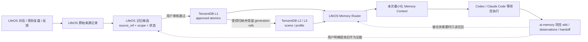

# LifeOS 外部记忆能力组合与数据权威

> 状态：阶段 8 修订后的目标架构决策（2026-10-03）
> 说明：目标是实际使用 `ai-memory` 与 TencentDB Agent Memory 的互补能力。当前代码已包含 loopback-only 的 ai-memory 项目只读适配器和 TencentDB v3 记忆适配器；本地 LifeOS Memory 仍是运行时权威，外部写入与召回尚未完成生产切换。

## 核心决策

1. **两个项目都是目标方案中的实际能力组件，不是“只作参考”或可有可无。** `ai-memory` 承担具体项目的 Agent 工作连续性；TencentDB Agent Memory 承担跨来源的分层长期认知（L1 原子、L2 场景、L3 画像）。
2. **LifeOS 是用户入口、授权/审核边界和编排中枢。** 它负责接收多源记录、确定用户/场景/项目范围、审核候选、决定何时调用哪种后端，并将带来源的结果组合到本次任务上下文。
3. **权威按数据职责划分，而非让三套系统保存同一份 active 记忆：** `ai-memory` 的 Git Markdown wiki 是具体 coding project 连续性的权威；TencentDB 是已审核长期认知 L1 及其 L2/L3 派生层的目标权威；LifeOS 保留来源记录、授权/候选/审核与跨系统引用。LifeOS 当前 `.lifeos/memory.json` 的 active Memory 是阶段 2–7 的本地 MVP，目标上属于迁移期实现，不应与 TencentDB 永久双写。
4. **LifeOS 审核先于语义记忆写入。** 新认知先成为带 source/scope 的 LifeOS 候选；用户确认后再提交给 TencentDB 的 L1。L2/L3 只能基于已审核的 L1 生成，必须保留回溯引用；不得把未经确认的项目内容自动提升成场景或全局认知。
5. **保留两类适配器的差异。** 不造一个抹平差异的万能 Memory CRUD 接口：`AiMemoryProjectAdapter` 对接项目查询、页面读取与 handoff；`TencentDBCognitiveAdapter` 对接 L0/L1 写入策略、L1/L2/L3 召回与生成溯源。LifeOS Router 只统一授权、范围、结果来源和上下文预算等编排约束。

## 职责与权威矩阵

| 数据/能力 | 目标权威 | LifeOS 职责 | 另一后端的边界 |
| --- | --- | --- | --- |
| LifeOS 对话、每日/阶段规划复盘、用户反馈的原始记录 | LifeOS 来源存储（当前结构化记录为 SQLite；各来源归档仍需补齐） | 记录来源 ID、时间、授权和保留策略；只提交必要内容 | TencentDB L0 可承载获准用于认知处理的对话/记录，但须保留 LifeOS source ref；是否复制全文或只存引用需阶段 9 验证 |
| coding Agent 项目 lifecycle、项目 wiki、决策、进展、handoff | **ai-memory 项目空间** | 按显式 project mapping 调用/呈现；保留外部 page/session/handoff 引用 | 不把整套项目 wiki 复制进 LifeOS/TencentDB；可转成 LifeOS 候选的仅是用户确认后要泛化的认知 |
| 已审核的长期原子认知 L1 | **TencentDB 目标权威** | 收集候选、执行用户审核、发起写入并保存审核/外部 ID 对应关系 | 不长期双写到 LifeOS active Memory；阶段迁移前旧 JSON store 暂为现行运行时权威 |
| 场景认知 L2、全局/场景画像 L3 | **TencentDB 目标派生层** | 决定哪些 scope 可参与当前任务，向用户呈现来源和生成依据 | 仅从 approved L1 生成；不得无证据跨项目/场景提升；无法追溯的输出不进入上下文 |
| 单次任务的混合上下文 | **LifeOS Memory Router** | 按 task + user + scenario + project 汇合 TencentDB 认知与 ai-memory 项目证据，限长并标注来源 | Router 是运行时组合，不是第三个持久化权威 |

“权威按数据职责划分”不代表无重复字节：同一已授权来源可能被引用或投影到另一个系统。必须保留稳定 `source_ref`、去重键和删除/更正关联；投影副本不能与来源权威冲突，也不能被误当作新的独立证据。

## 目标数据流

这是目标链路，不是当前代码现状。当前 `ChatRuntime` 仍只调用 LifeOS 本地 `MemoryManager`，既没有调用 `ai-memory`，也没有调用 TencentDB。图中 L0/L1/L2/L3 具体写入和生成 API 必须经阶段 9 的接口核对与测试后才能落为代码。

## 适配边界

### `AiMemoryProjectAdapter`

- 目标用途：编码/项目任务开始时按明确 workspace/project identity 查询相关 wiki、handoff 或近期进展；需要时读取指定页面。
- 项目身份必须由用户/项目设置显式绑定到 ai-memory 的 workspace/project 坐标；禁止仅凭模糊项目名猜测。缺失或歧义时跳过外部项目召回，不能 fallback 到全局检索。
- 对已配置的 Codex/Claude Code 项目，复用 ai-memory 自身的 hooks/lifecycle capture、MCP/HTTP 和项目隔离，不由 LifeOS 再抓一份相同执行日志或复制 wiki；LifeOS 另通过项目 adapter 查询/读取所需上下文。
- 召回作为带 provider/page/session ref 的外部项目证据；如需变成通用用户认知，回到 LifeOS 候选和审核，再由 TencentDB 保存。

### `TencentDBCognitiveAdapter`

- 目标用途：让 LifeOS 来源在授权后进入 TencentDB 记忆管线，管理已审核的 L1，并召回相关 L1/L2/L3 认知及 generation refs。
- 新接入优先评估上游推荐的 v3 API/SDK，并稳定映射 LifeOS `user_id`、`project_id`、`scenario_type` 到 `team_id`、`agent_id`、`user_id` 和 session 等坐标；禁止用固定默认 ID 代替真实隔离。
- 公开文档列出了 v3 conversation/atomic/scenario/core 路由及身份字段，但没有证明它提供与 LifeOS 等价的 pending-candidate/user-approval 工作流。必须先验证“先审核再写 L1”的可实现方式；未解决前不可启用自动提取到生产数据。
- TencentDB 的 L2/L3 是长期认知能力的目标组成，不是仅供展示的可选参考；但生成结果需要 generation refs，且范围和上游 approved L1 可解释。缺来源、scope 不符或 generator 故障时不注入模型。

#### 当前 v3 适配器配置

- `LIFEOS_TDAI_ENDPOINT`、`LIFEOS_TDAI_SERVICE_ID`、`LIFEOS_TDAI_TEAM_ID`、`LIFEOS_TDAI_AGENT_ID`、`LIFEOS_TDAI_USER_ID` 必须显式提供；当前只允许 loopback Gateway。全局记忆使用这组基础身份。
- 项目和场景必须通过 `LIFEOS_TDAI_SCOPE_MAP` 显式映射为 `team_id`、`agent_id`、`user_id`、`session_id`。未映射的范围不会查询或写入 TencentDB；不得回退到全局身份。
- 映射格式示例：`{"project:lifeos":{"team_id":"...","agent_id":"...","user_id":"...","session_id":"..."}}`。每个映射必须且只能包含这四个非空字符串字段。
- 每条已同步记忆会记录远端身份映射指纹。映射改变后，更新/删除会 fail closed，避免按新身份操作旧远端记录。
- 新记忆写入依赖 Gateway 的 `POST /v3/atomic/create`。`LIFEOS_TDAI_ALLOW_ATOMIC_CREATE` 默认关闭；只有部署的 Gateway 明确支持该端点并通过隔离验收后才可开启。更新仍使用 `/v3/atomic/update`，不以 upsert 代替 create。
- 当前证据仅覆盖合成数据下单条记录的真实 Gateway 生命周期；多条首次 create 的上游问题仍未解决。LifeOS 本地记录继续保留为权威，失败写入保持 pending，可在问题修复后重试。

## 迁移与切换原则

当前 LifeOS 阶段 2–7 已有 `.lifeos/memory.json`、候选生命周期、范围检索和画像 UI。接入 TencentDB 时采用一次明确切换，不长期双写：

1. 盘点并导出当前 active/candidate 数据及来源引用，映射到 TencentDB 的用户/项目/场景坐标；无法映射的保持待处理，不猜测范围。
2. 用独立测试租户验证导入幂等、读取、纠正、撤回、画像来源与隔离；对照检查数量、ID/source refs 和 scope。
3. 验收后切换权威：新 active L1 只写 TencentDB；LifeOS 留存审核/审计状态和外部 ID/ref，本地旧 active store 只读归档并提供回滚窗口。
4. 验收失败则继续使用 LifeOS 本地 store，不做半切换；不同时开启两处写入。

L0 的保存策略、候选审批如何映射 TencentDB 写 API、跨系统纠正/撤回/删除语义是阶段 9 必须用实际接口验证的阻塞设计点，当前文档不假设已解决。

## 阶段 9 后续实施次序

1. **TencentDB vertical slice（认知核心）**：隔离测试实例；确认 v3 读写/身份/生成引用和审核前置写入方案；用合成数据完成一条 LifeOS candidate → 用户批准 → L1 → L2/L3 → 带来源召回链路。
2. **ai-memory project slice（项目连续性）**：为一个测试项目配置稳定身份映射；接入项目检索、handoff/page 引用；验证相邻项目隔离和 provider 故障不阻断本地 Memory。
3. **LifeOS Router 组合**：两个不同适配器按任务模式组合；保留原生能力差异，但在上下文输出中统一 provenance、scope 与限长元数据。
4. **迁移与回滚**：对现有 LifeOS active Memory 做一次性导入、对照、切换/回滚计划，完成前禁止生产双写。
5. **阶段 10 再评估召回质量与成本/效率**：先测正确性、隔离与来源可解释性，再量化延迟、LLM/embedding 成本及缓存收益。

## 上游依据与版本说明

- [`ai-memory` 架构](https://github.com/akitaonrails/ai-memory/blob/main/docs/ARCHITECTURE.md)：Git Markdown wiki 为事实来源，SQLite 为派生索引；支持 hooks、MCP/HTTP、项目召回和 handoff。LifeOS 应借它解决项目 Agent 连续性，而不是再造同一套 wiki。
- [TencentDB MemoryCore 文档](https://github.com/TencentCloud/TencentDB-Agent-Memory/blob/feat/server_team/MemoryCore/README_CN.md)：描述 L0 conversation、L1 atomic、L2 scenario、L3 core profile、HTTP/SDK；推荐新接入 v3，并要求 team/agent/user 隔离坐标。官方文档当前没有证明 LifeOS 所需的审批前置语义，因此列为实施前验证项。
- 本地 `upstream/ai-memory` 当前检出的 `docs/codex-shared-daemon-recovery` / `82b9c581` 不是 `main`；本地分支仅作辅助材料，正式集成前继续以当时上游文档和 API 合约为准。

## 当前未实现项

- 两个外部系统的运行时适配、身份映射、服务配置、授权界面及统一 Router 调用。
- TencentDB 侧 candidate/approval gate 的具体映射；L0 原始内容使用复制还是引用的保留策略。
- 从 LifeOS 本地 active Memory 到 TencentDB 的迁移与单点切换。
- `ai-memory` 外部项目召回在不同任务模式下的选择/限额策略。
- 跨后端更正、撤回、删除与 provider down 时的回滚测试。
