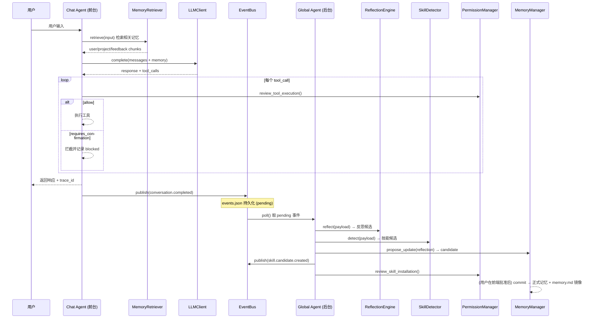
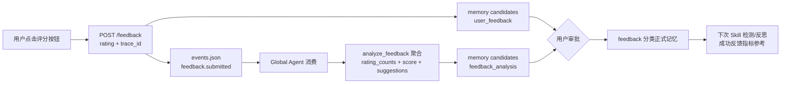
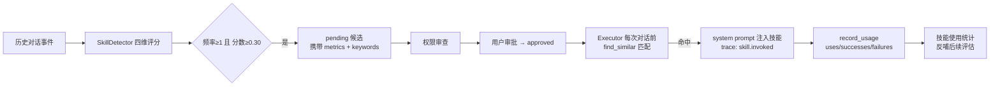

# LifeOS Agent 技术栈与系统架构讲解（面试用）

> 本文从宏观到微观，覆盖：项目定位 → 技术栈全景 → 各技术栈特点与用法 → 系统架构分层 → 数据流转链路 → 关键模块微观实现 → 面试高频追问与诚实边界。
> 所有描述基于仓库 `codex/lifeos-core-update` 分支实际代码，标注"当前状态"的均为如实说明。

---

## 一、宏观：项目是什么

LifeOS Agent 是一个**面向个人成长场景的伴随式自进化智能体系统**。核心理念是"个人智能操作系统"：把用户的日常记录、任务规划、项目上下文、反馈信息与 Agent 执行过程统一管理，形成**感知 → 决策 → 执行 → 沉淀 → 进化**的完整闭环。

针对的痛点：现有 AI 助手上下文短暂、无长期记忆、无法持续理解用户、经验无法沉淀。

三个核心能力（也是简历三大块）：

| 能力 | 一句话 | 对应模块 |
|------|--------|---------|
| Skill Evolution | 从重复任务中自动提炼技能，后续主动复用 | `lifeos/skills/` |
| 长期 Memory | 文件化、可读可编辑可审计的长期记忆 | `lifeos/memory/` |
| Reflection Engine | 基于用户反馈与历史 Trace 的反思进化 | `lifeos/reflection/` |

架构上拆成**前台 Chat Agent（快路径）**与**后台 Global Agent（维护路径）**，中间用**可靠事件总线**解耦——这是整个系统最重要的设计决策。

---

## 二、技术栈全景

| 层 | 技术 | 版本/形态 | 角色 |
|----|------|----------|------|
| 后端语言 | Python | 3.11+，纯标准库 | Agent 运行时、API 服务 |
| 异步 | asyncio | 标准库 | 前台/后台 Agent 并发、事件处理 |
| HTTP API | http.server (BaseHTTPRequestHandler) | 标准库，无框架 | 自建 REST API（8765 端口）|
| 结构化存储 | SQLite (sqlite3) | 标准库，WAL 模式 | 用户计划/复盘/日记/反馈（lifeos.db）|
| 文件存储 | JSON 文件 | 标准库 json | 记忆/事件/技能注册（.lifeos/*.json）|
| Markdown 镜像 | 自研 render/parse | `lifeos/memory/export.py` | 记忆的人类可读可编辑界面（memory.md）|
| LLM 接入 | LLMClient 统一接口 | 当前 mock provider | 对话/反思/技能检测的模型入口（可替换）|
| 前端框架 | React 18 + TypeScript 5 | Vite 5 构建 | 控制台 UI（5173 端口）|
| 前端样式 | 纯手写 CSS（CSS 变量）| 无 UI 库 | 暗色主题控制台 |
| 构建/代理 | Vite dev proxy | `/api` → `127.0.0.1:8765` | 前后端联调 |

**特点：后端零第三方依赖。** 全部用 Python 标准库实现（asyncio + http.server + sqlite3 + json），这既是刻意选择（原型可移植、可解释、无部署成本），也是面试可以讲的设计取舍。

---

## 三、各技术栈特点与用法

### 3.1 Python + asyncio（后端运行时）

**特点**：单进程事件循环，天然适合 IO 密集的 Agent 场景（LLM 调用、文件读写、事件处理都是 await 边界）。

**用法**：
- `LifeOSAgent.run()` / `run_background_once()` 都是 async 入口，API server 用 `asyncio.run()` 桥接同步的 http.server。
- 前台 Chat 与后台 Global Agent 共享同一个事件循环，后台处理不会阻塞前台响应。
- `planner.py` / `executor.py` 全部 async 化，为后续接真实 LLM 的 IO 等待预留。

```python
# lifeos/agent/runtime.py — 组合根
self.chat = ChatRuntime(llm, memory, executor, event_bus, trace)
self.global_agent = GlobalAgentRuntime(event_bus, memory, reflection, skill_detector, ...)
```

**面试点**：为什么用 asyncio 而不用多线程？——Agent 场景的瓶颈是模型推理与 IO 等待，事件循环单线程即可支撑；多线程还会引入共享状态（如 memory store）的并发问题，asyncio 单线程 + await 天然规避。

### 3.2 http.server 自建 API（无框架）

**特点**：零依赖、足够用。实现了 GET/POST/PUT 三类方法、JSON 编解码、参数解析、错误码（400/404）。

**用法**（当前路由表）：

| 方法 | 路径 | 作用 |
|------|------|------|
| POST | `/chat` | 前台对话 |
| POST | `/background/run-once` | 手动触发后台处理一轮 |
| POST | `/feedback` | 提交用户评分反馈 |
| POST | `/entries` / PUT `/entries/:id` | 结构化记录（计划/复盘/日记/反馈）|
| GET | `/entries?kind=` | 按类型查记录 |
| GET | `/memory/markdown` | 导出记忆 Markdown |
| POST | `/memory/markdown` | 导入编辑后的 Markdown |

**面试点**：为什么不用 FastAPI/Flask？——原型阶段避免依赖地狱，标准库足够；如果未来需要 OpenAPI 文档、自动校验、WebSocket，可以平滑迁移（路由和 handler 是纯函数式结构，迁移成本低）。

### 3.3 SQLite + JSON 文件双轨存储

**特点**：两种存储各司其职——**结构化用户内容**（有 schema、需要查询）进 SQLite；**Agent 运行时状态**（动态 schema、需要审计）进 JSON 文件。

**SQLite（lifeos.db）**：
- 单表 `structured_entries`：id/kind/entry_date/title/content/mood/metadata_json/时间戳
- WAL 模式、外键开启、`kind+date` 复合索引
- kind 枚举校验：daily_plan / daily_review / phase_plan / phase_review / diary / insight / feedback
- 前端"每日规划/复盘/日记/心得/反馈"页面全部走它

**JSON 文件（.lifeos/）**：
- `memory.json`：长期记忆（user/project/feedback/reference + candidates/backups/vector_index/cache）
- `events.json`：可靠事件队列
- `skills.json`：技能注册表（approved/pending + usage 统计）
- `memory.md`：记忆的 Markdown 镜像（可读可编辑可审计）

**面试点**：为什么记忆不用 SQLite 而用 JSON？——记忆条目是**半结构化嵌套**（content 是任意 dict），JSON 保真存储 + 整体读改写简单；SQLite 的强 schema 反而增加写入约束。两种场景分开，是"用什么存什么"而非"统一一个库"。

### 3.4 Markdown 导出/导入层（自研）

**特点**：JSON 是内部真相（保真），Markdown 是文件化界面（可读）。`export.py` 提供 `render_markdown`（store → md）与 `parse_markdown`（md → store）两个纯函数，双向同步。

**用法**：
- 每次记忆 commit 后自动刷新 `.lifeos/memory.md` 镜像
- 前端 Memory 面板 Markdown tab：直接编辑 + Import 写回
- 格式：`## 分类 (n)` → `### 序号. id - 时间 [source: xxx]` → JSON 代码块内容

**面试点**：这就是简历里"基于 Markdown 文件系统的长期记忆"的落地点——内部 JSON 保证结构化无损，Markdown 层给用户可读可编辑的界面，与 TencentDB Agent Memory"Persona 存 Markdown 文件"的理念对齐，但用导入导出代替它的自动同步。

### 3.5 LLMClient 统一接口（当前 mock）

**特点**：所有模型调用收敛到一个接口 `complete(messages, tools)`，返回统一结构（content/tool_calls/usage）。**当前状态：只有 mock provider**（provider 非 mock 会抛 NotImplementedError），真实 API 是预留的扩展点。

**用法**：
- Executor 对话调用 → `llm.complete(...)`
- ReflectionEngine / SkillDetector 也持有 llm 实例（架构上已就位）

**面试点（必须诚实）**：目前是 mock 响应，真实模型是下一步接入项。接口设计（统一 complete + provider 切换）就是为接 OpenAI 兼容端点准备的——这是"架构先行、实现后补"的典型取舍。若被问"效果如何"，答：系统闭环逻辑全部跑通（见验证章节），模型层是唯一 mock 的部分。

### 3.6 React 18 + TypeScript + Vite（前端）

**特点**：TypeScript 全类型（API 类型与后端数据形状一一对应）、React 函数组件 + hooks、useReducer 集中状态管理、无 UI 库（手写 CSS 变量暗色主题）。

**用法**：
- `store.ts`：单一 store（messages/events/memory/skills/permissions/pipeline/ui），reducer 模式，所有面板共享
- 面板组件：ChatPanel / MemoryPanel / SkillsPanel / TracePanel / EventsPanel / PermissionsPanel / RuntimeRail / DataFlowView
- `api/client.ts`：typed API client，`safeGet` 模式——后端未实现的端点自动回退 mock 数据并打 "preview" 徽标，用户能区分真实数据与预览数据
- Vite proxy：dev 时 `/api` → `127.0.0.1:8765`，前端无 CORS 问题

**面试点**：`safeGet` 回退设计很有讲头——前端可以先于后端开发，mock 数据与真实数据用 `source: "backend" | "preview"` 标记，既保证开发效率又保证数据可信度（面板角落的徽标）。

---

## 四、系统架构分层

```
┌─────────────────────────────────────────────────────────┐
│  表现层  React 18 控制台 (5173)                          │
│  ChatPanel · MemoryPanel · SkillsPanel · TracePanel ...  │
└──────────────────────────┬──────────────────────────────┘
                           │ /api (Vite proxy, 无 CORS)
┌──────────────────────────▼──────────────────────────────┐
│  API 层  http.server (8765)                              │
│  /chat · /feedback · /background/run-once · /entries     │
│  /memory/markdown                                        │
└──────────────────────────┬──────────────────────────────┘
┌──────────────────────────▼──────────────────────────────┐
│  运行时层  LifeOSAgent (asyncio 单进程)                   │
│  ┌─────────────┐    可靠事件总线    ┌─────────────────┐  │
│  │ Chat Agent  │ ──publish──▶      │  Global Agent   │  │
│  │ (快路径)    │   events.json      │  (维护路径)      │  │
│  │ memory检索  │                    │ reflection      │  │
│  │ LLM/工具执行│                    │ skill 检测      │  │
│  │ 权限审查    │                    │ memory candidate│  │
│  └─────────────┘                    └─────────────────┘  │
└──────────┬───────────────────────────────┬──────────────┘
           │                               │
┌──────────▼──────────┐        ┌───────────▼──────────────┐
│ 存储层              │        │ 安全层                   │
│ memory.json         │        │ PermissionManager        │
│ events.json         │        │ 高危工具 → 需确认         │
│ skills.json         │        │ 高危技能 → 需确认         │
│ memory.md (镜像)    │        └──────────────────────────┘
│ lifeos.db (SQLite)  │
└─────────────────────┘
```

**设计要点**：
1. **前台/后台分离**：对话快路径不等待反思、技能检测等重活——发完事件就返回，用户无感知延迟。
2. **事件总线是硬边界**：前台只 publish，后台只 consume，二者不直接调用，天然可重试、可审计。
3. **两阶段写入**：记忆不直接落库，先 candidate 再 commit，中间有安全审查与用户审批窗口。
4. **权限模型拆两半**：工具执行确认 与 技能安装/持久化确认 分开（split permission model）。

---

## 五、数据流转链路（核心）

### 5.1 一次对话的完整流转（主链路）



**关键细节**：
- 每个请求生成 `trace_id`，从进入 Chat Agent 到事件落库全程携带，前端 TracePanel 可回溯每一步。
- 事件状态机：`pending → processing → done / failed`，失败可重试（attempts 计数）。
- 记忆不自动 commit——candidate 等用户审批（前端 Memory 面板 Approve），这是"两阶段写入"对记忆质量的保证。

### 5.2 反馈驱动进化链路（新增闭环）



四种评分（与反射引擎权重对应）：`plan_too_heavy(-1.0)` / `just_right(+0.5)` / `helpful(+1.0)` / `not_helpful(-1.0)`。

### 5.3 Skill 自动提炼与主动调用链路



四维指标：频率（历史相似任务数）、相似度（关键词命中率+token 覆盖率）、复杂度（工具调用深度）、成功反馈（工具成功率+用户评分），加权 `0.30/0.35/0.15/0.20`。

---

## 六、微观：关键模块实现要点

### 6.1 记忆检索（模糊匹配）

三信号取 max，按分类排序返回：

| 信号 | 说明 | 例子 |
|------|------|------|
| 子串命中 | query 完整出现在内容里 → 1.0 | "计划" 命中"喜欢拆成小任务" |
| CJK 字符覆盖率 | 查询字集合在内容中的占比 | "周规划" vs "周计划" 共享 周/划 → 0.67 |
| bigram/Jaccard | 2-gram 分词重叠 | 捕捉短中文词组级相似 |

阈值 0.4（默认），返回条目按分数降序。局限：语义近义但字面无关（"偏好" vs "喜欢"）匹配不到——这就是未来 embedding 检索的切入点。

### 6.2 Trace 系统（可观测性）

内存字典 `records[trace_id] = {input, created, events[]}`，`start/event/get` 三个方法。每个环节调用 `trace.event(id, name, data)` 记录：memory.retrieved / chat.executed / skill.invoked / conversation.completed。

### 6.3 Memory 两阶段写入

```
propose(source, content, trace_id) → candidate
commit_candidate(id) → validate → backup(全量快照) → apply(按 source 路由分类)
                     → vector_upsert → cache_invalidate → 刷新 memory.md
```

source → 分类路由：`direct→user` / `user_feedback→feedback` / `reflection→project` / `external→reference` / 未知→project（兜底不丢）。

### 6.4 权限模型

```python
HIGH_RISK_ACTIONS = {"write_file", "delete_file", "send_email", "install_skill"}
```
- 高危工具调用 → `requires_confirmation`（前端 PermissionsPanel 处理）
- 高危技能候选（risk=high）→ 安装需确认

### 6.5 技能注册表

`skills.json` 结构：`{approved: [{...skill, usage: {uses, successes, failures, last_used_at}}], pending: []}`。`find_similar(query)` 按关键词相似度排序返回，供 Executor 主动调用。

---

## 七、面试高频追问与诚实边界

| 可能的问题 | 建议回答要点 |
|-----------|-------------|
| "LLM 是真实调用的吗？" | 接口已统一（LLMClient.complete），当前为 mock provider 保证闭环可跑，接入 OpenAI 兼容端点即可替换——架构先行、实现后补 |
| "记忆检索怎么做？" | 模糊匹配：子串命中（1.0）+ CJK 字符覆盖率 + bigram/Jaccard 三信号取 max，阈值 0.4，分类内按分数排序；语义近义（如"偏好"vs"喜欢"）字面无重叠时不命中——这是纯字面检索的边界，vector_index 字段已预留，可升级 embedding 语义检索 |
| "和 TencentDB Agent Memory 什么关系？" | 借鉴"文件即记忆、渐进式沉淀、可审计"理念；未实现其 L0-L3 语义金字塔与双路召回——个人原型做了简化取舍 |
| "为什么 memory 用 JSON 不用数据库？" | 半结构化嵌套内容保真优先；SQLite 留给有 schema 的用户内容 |
| "事件总线为什么不直接用消息队列？" | 本地单进程场景，JSON 文件队列足够且零依赖；状态机 + 重试已满足审计需求 |
| "前后端如何联调？" | Vite proxy 转发 /api，前端 safeGet 在端点缺失时回退 mock 并打 preview 徽标 |

### 当前状态清单（诚实盘点）

| 模块 | 状态 |
|------|------|
| 对话/事件/记忆/技能/反馈 闭环 | ✅ 全部跑通（单元 + 端到端验证）|
| LLM 真实接入 | ⚠️ mock，接口预留 |
| 检索 | ✅ 模糊匹配（子串+字符覆盖率+bigram/Jaccard）；⚠️ 语义/向量检索未实现（字段已预留）|
| Skill 语义检测 | ⚠️ 规则实现（关键词+频率），LLM 语义层可后置叠加 |
| 前端 | ✅ 全功能（含评分按钮、Markdown 编辑、技能指标展示）|

---

## 八、一句话总结（30 秒电梯陈述）

> "LifeOS Agent 是一个个人成长场景的自进化 Agent 原型：React 控制台 + 纯标准库 Python 后端，用可靠事件总线解耦前台对话与后台维护，通过 candidate→commit 两阶段写入实现可审计的长期记忆（JSON 内部 + Markdown 可编辑界面），通过四维指标从重复任务中自动提炼技能并主动复用，通过用户评分反馈驱动反思分析——形成一个'对话→沉淀→反馈→进化'的完整闭环。"
